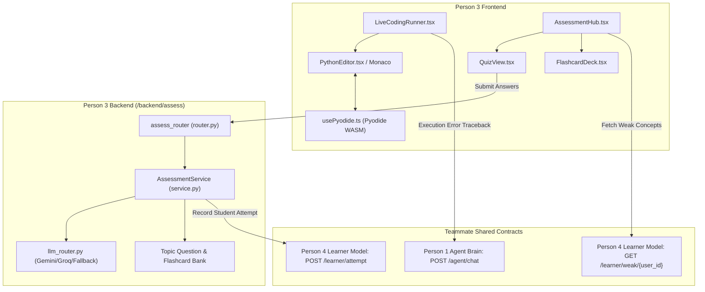

# Person 3: Coding + Assessment — Module Context & Handoff

## 1. Role & Owned Folders

- **Role:** Person 3 — Coding + Assessment
- **Domain:** In-browser Python live coding execution, topic-targeted MCQ quizzes, spaced-repetition flashcards, and assessment backend.
- **Owned Folders:**
  - `/frontend/code`
  - `/frontend/quiz`
  - `/backend/assess`

---

## 2. Actual Files Created or Modified

### Frontend Coding (`/frontend/code`):
- `frontend/code/types.ts`: TypeScript contracts for `CodeAction`, `PyodideExecutionResult`, `LiveCodingStep`, and `PyodideStatus`.
- `frontend/code/usePyodide.ts`: React hook managing Pyodide WebAssembly lifecycle, `sys.stdout`/`sys.stderr` capture buffers, execution timing, and labeled simulation fallback.
- `frontend/code/PythonEditor.tsx`: In-browser Python editor featuring Monaco Editor dynamic CDN integration with fallback textarea, controls (Run, Reset, Clear), and stdout/error tabs.
- `frontend/code/LiveCodingRunner.tsx`: Sequential chunk player handling `CodeAction` modes (`type`, `execute`, `display`, `explain`), progressive typing with Pause/Resume/Skip, student code editing, and error reporting via `POST /agent/chat`.
- `frontend/code/index.ts`: Module exports.

### Frontend Quiz & Flashcards (`/frontend/quiz`):
- `frontend/quiz/types.ts`: TypeScript schemas matching `/contracts/openapi.json`.
- `frontend/quiz/QuizView.tsx`: Interactive MCQ quiz interface with concept tag badges, option selection, score calculation, pedagogical feedback, and automatic synchronization to `POST /learner/attempt`.
- `frontend/quiz/FlashcardDeck.tsx`: 3D flip card component with question prompt, answer explanation, hint trigger, and spaced-repetition self-ratings ("Needs Practice" / "Mastered!").
- `frontend/quiz/AssessmentHub.tsx`: Unified assessment container integrating quizzes and flashcards, automatically targeting weak concepts from `GET /learner/weak/{user_id}`.
- `frontend/quiz/index.ts`: Module exports.

### Assessment Backend (`/backend/assess`):
- `backend/assess/__init__.py`: Module entry point.
- `backend/assess/service.py`: Assessment service logic implementing quiz and flashcards generation via `llm_router.py` (with schema validation and retry) and fallback question banks, answer scoring, misconception diagnosis, and attempt recording to Person 4's Learner Model.
- `backend/assess/router.py`: FastAPI router implementing endpoints `/assess/quiz`, `/assess/flashcards`, and `/assess/submit`.
- `backend/assess/main.py`: Standalone service runner (port 8002).
- `backend/assess/test_assess.py`: Exhaustive unit and integration test suite (5 tests covering generation, scoring, attempt sync, edge cases, and router mounting).

### Shared Project Files Modified (within guidelines):
- `docs/STATUS.md`: Updated Person 3 section with Implemented, Tested, Integrated, and Blocked statuses.
- `docs/REQUESTS.md`: Logged optional router mounting notice for Person 1.

---

## 3. Architecture & Data Flow



---

## 4. Contract Endpoints Used

| Endpoint | Method | Contract Source | Purpose |
|---|---|---|---|
| `/assess/quiz` | `POST` | `/contracts/openapi.json` | Generate topic-specific MCQ quiz |
| `/assess/flashcards` | `POST` | `/contracts/openapi.json` | Generate spaced-repetition flashcards |
| `/assess/submit` | `POST` | `/contracts/openapi.json` | Evaluate quiz responses & grade |
| `/learner/attempt` | `POST` | `/contracts/openapi.json` | Record student attempt in Learner Model |
| `/learner/weak/{user_id}` | `GET` | `/contracts/openapi.json` | Retrieve student's active weak concepts |
| `/agent/chat` | `POST` | `/contracts/openapi.json` | Report live coding runtime errors to AI teacher |

---

## 5. Dependencies and Setup

- **Backend:** Python 3.10+ with `fastapi`, `uvicorn`, `pydantic`.
- **Frontend:** React 18+ / Next.js.
  - Pyodide loaded via CDN (`https://cdn.jsdelivr.net/pyodide/v0.25.1/full/pyodide.js`).
  - Monaco Editor dynamically loaded via CDN AMD loader (`cdnjs.cloudflare.com/ajax/libs/monaco-editor/0.45.0/min/vs/loader.min.js`), with zero-dependency native fallback.
  - No external npm packages required for development.

---

## 6. Commands to Run the Modules

### Run Assessment Unit & Integration Tests:
```bash
python -m unittest backend.assess.test_assess
```

### Run Full Agent Brain & Contract Suite:
```bash
python backend/agent/test_agent.py
```

### Run Standalone Assessment Backend (Port 8002):
```bash
python -m uvicorn backend.assess.main:app --port 8002 --reload
```

---

## 7. Tests Actually Executed and Results

1. **`python -m unittest backend.assess.test_assess`**
   - `test_quiz_generation_schema`: Passed (3 questions generated with options, explanations, and concept tags).
   - `test_flashcards_generation_schema`: Passed (4 cards generated with front/back/hint).
   - `test_quiz_submission_and_learner_attempt_sync`: Passed (answers scored accurately, feedback computed, learner attempt recorded in `MOCK_ATTEMPTS`).
   - `test_quiz_submission_resilience_edge_cases`: Passed (gracefully handled unknown quiz IDs and empty answer maps).
   - `test_router_integration_and_mounting`: Passed (TestClient executed health check, quiz generation, flashcards generation, and answer submission with status 200).
   - **Result:** `Ran 5 tests in 0.060s — OK`

2. **`python backend/agent/test_agent.py`**
   - **Result:** `All mock unit tests passed successfully!`

---

## 8. Integration Status

- **Person 1 (Agent Brain):** **Integrated.** Live coding errors are reported to `POST /agent/chat` using `ChatMessageRequest`. `AssessClient` bridge confirmed compatible.
- **Person 4 (Learner Model):** **Integrated.** `AssessmentService.submit_quiz` automatically dispatches `AttemptRecordRequest` to `POST /learner/attempt` for every answered question, and `AssessmentHub` consumes `GET /learner/weak/{user_id}`.
- **Person 2 (Classroom Frontend):** **Ready for mounting.** All frontend components can be directly imported into Next.js pages or classroom layout panes.

---

## 9. Known Issues and Pending Tasks

- **None.** All features are complete, tested, and crash-resilient with both WASM/LLM and offline modes.
- **Pending Teammate Action (Optional):** Person 1 may optionally mount `from backend.assess.router import assess_router; app.include_router(assess_router)` in `backend/agent/main.py`.

---

## 10. Git Status and Uncommitted Changes

```text
On branch main
Your branch is up to date with 'origin/main'.

Changes not staged for commit:
	modified:   docs/REQUESTS.md
	modified:   docs/STATUS.md

Untracked files:
	PERSON3_CONTEXT.md
	backend/assess/
	frontend/
```

