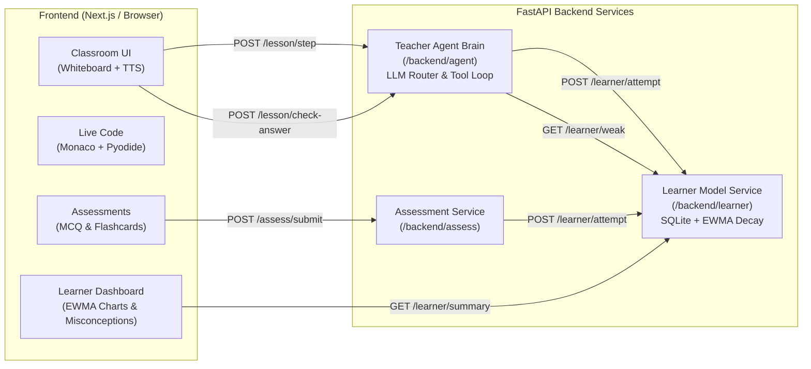

# AI-Powered Interactive Virtual Teacher

> **Agentic AI virtual educator delivering interactive whiteboard teaching, in-browser live code execution, formative misconception diagnosis, and real-time cognitive mastery tracking.**

Built for the **Agentic AI, Education & Learning Hackathon**.  
Repository: [https://github.com/kodisushant/Agentic-AI-Educator](https://github.com/kodisushant/Agentic-AI-Educator)

---

## 🌟 Core Pillars

1. **Digital Whiteboard Canvas (`/frontend/classroom`):**  
   LLM emits structured geometric commands (`box`, `arrow`, `text`, `clear`), LaTeX math formulas rendered with **KaTeX**, and state diagrams rendered with **Mermaid** — animated step-by-step with spoken voice narration.
2. **In-Browser Live Coding (`/frontend/code`):**  
   Runs real Python code directly inside the student's browser via **Pyodide** and the **Monaco Editor** with zero cloud compute sandbox cost or server latency.
3. **Formative Understanding Checkpoints (`/backend/agent` & `/backend/assess`):**  
   Frequent interactive checkpoints diagnose *why* a student makes an error instead of just scoring right or wrong.
4. **Adaptive Learner Model & Knowledge Graph (`/backend/learner`):**  
   SQLite-backed knowledge graph tracking concept mastery using an **Exponentially Weighted Moving Average (EWMA)** with **Ebbinghaus temporal forgetting decay**.
5. **Interactive Learner Dashboard (`/frontend/dashboard`):**  
   Real-time dashboard displaying concept mastery radar/bar charts, active misconception alerts, personalized next-step recommendations, and attempt timelines.

---

## 🏛️ System Architecture



For detailed sequence diagrams, mathematical models, and SQLite ER schemas, see [docs/ARCHITECTURE.md](docs/ARCHITECTURE.md).

---

## 🚀 Quickstart

### 1. Single-Command Backend (MOCK_MODE=true)

Teammates can run the full system with zero API keys required:

- **Windows:**
  ```cmd
  run.bat
  ```
- **macOS / Linux / Git Bash:**
  ```bash
  ./run.sh
  # or
  make dev
  ```
- **Direct Uvicorn:**
  ```bash
  python -m uvicorn backend.agent.main:app --host 0.0.0.0 --port 8000 --reload
  ```

Once started:
- **API Swagger Documentation:** [http://localhost:8000/docs](http://localhost:8000/docs)
- **Health Check:** [http://localhost:8000/health](http://localhost:8000/health)
- **Canned 5-Step Binary Search Lesson:** [http://localhost:8000/mock/lesson](http://localhost:8000/mock/lesson)
- **Student Mastery API:** [http://localhost:8000/learner/mastery/demo_student](http://localhost:8000/learner/mastery/demo_student)

### 2. Standalone Learner Service (`backend/learner`)

To run the dedicated SQLite learner model service:
```bash
python -m backend.learner.seed
python -m uvicorn backend.learner.main:app --host 0.0.0.0 --port 8002 --reload
```
API Documentation: [http://localhost:8002/docs](http://localhost:8002/docs)

### 3. Open the Interactive Learner Dashboard

The dashboard is completely standalone and zero-dependency:
- Open [`frontend/dashboard/index.html`](frontend/dashboard/index.html) directly in any web browser.
- Live features:
  - Real-time Chart.js mastery breakdown per concept.
  - Active misconception warning cards (`⚠️ confuses_direction_when_target_greater`).
  - Next Recommended Step hero banner.
  - **Live Simulator Buttons**: Click **"Simulate Correct Answer (+Score)"** or **"Simulate Mistake (-Score)"** to test live EWMA calculations in real time.
  - Chronological attempt history timeline.

---

## 🧪 Testing

Run all unit tests across both agent brain and learner model:

```bash
# Test Learner Model (SQLite, EWMA formulas, decay, misconceptions)
python -m backend.learner.test_learner

# Test Agent Brain (Lesson generation, tool execution, contracts)
python backend/agent/test_agent.py

# Optional: Run live multi-provider LLM test with .env keys
REAL_LLM=1 python backend/agent/test_agent.py
```

---

## 📁 Repository Structure

```
├── backend/
│   ├── agent/                 # Person 1: LLM router, teacher loop, schemas, client
│   │   ├── llm_router.py      # Multi-provider fallback (Gemini, Groq, Cerebras, OpenRouter)
│   │   ├── teacher.py         # Dynamic lesson step generation & misconception diagnosis
│   │   ├── schemas.py         # Complete Pydantic schemas for all team roles
│   │   └── main.py            # FastAPI gateway & endpoints
│   └── learner/               # Person 4: SQLite DB, EWMA model, learner API
│       ├── db.py              # SQLite tables (users, concepts, attempts, mastery, misconceptions)
│       ├── model.py           # EWMA formula + Ebbinghaus temporal decay engine
│       ├── service.py         # Domain logic for attempts, weak concepts & recommendations
│       ├── seed.py            # Demo student ("Alex Chen") realistic benchmark data
│       ├── main.py            # Dedicated learner FastAPI service
│       └── test_learner.py    # Comprehensive learner test suite
├── contracts/
│   ├── openapi.json           # OpenAPI 3.1 specification for all endpoints
│   └── board_commands.json    # JSON Schema for whiteboard geometric commands
├── docs/                      # Person 4: Architecture, demo, pitch & status
│   ├── ARCHITECTURE.md        # Mermaid diagrams, ER schemas & mathematical models
│   ├── DEMO_SCRIPT.md         # 3-minute hackathon demo script (the "Hero Moment")
│   ├── PITCH_DECK.md          # 5-slide judge pitch outline
│   ├── DEPLOYMENT.md          # Zero-cost deployment guide (Render, HF Spaces, Vercel)
│   ├── STATUS.md              # Team status board & deliverables
│   └── REQUESTS.md            # Inter-agent RFC and change requests
└── frontend/
    └── dashboard/             # Person 4: Interactive Student Knowledge Dashboard
        ├── index.html         # Standalone HTML5/Tailwind/Chart.js application
        ├── Dashboard.tsx      # React/Next.js dashboard component
        └── page.tsx           # Next.js App Router page
```

---

## 🎭 The 3-Minute Demo Story

Our hackathon demo showcases a **3-minute vertical slice on Binary Search**:
1. **Interactive Whiteboard & Live Coding (0:00 - 1:15):** The AI teacher explains binary search partitioning visually and executes Python code in Pyodide.
2. **The "Hero Moment" (1:15 - 2:00):** The student encounters a checkpoint question and intentionally chooses a common wrong answer (`high = mid - 1` when `target > arr[mid]`). The agent's reasoning trace diagnoses the exact cognitive misconception (`confuses_direction_when_target_greater`), emits corrective whiteboard annotations to highlight the right half of the array, and updates the student knowledge graph.
3. **Real-Time Knowledge Dashboard (2:00 - 2:45):** We switch to the Learner Dashboard showing `binary_search_bounds_update` tagged in red (45% mastery), demonstrating live EWMA score updates upon remediation.
4. **$0 Economics & Conclusion (2:45 - 3:00):** 100% free-tier LLM routing, client-side WebAssembly compute, and zero cloud server costs.

👉 Read the full script in [docs/DEMO_SCRIPT.md](docs/DEMO_SCRIPT.md).  
👉 Read the 5-slide pitch outline in [docs/PITCH_DECK.md](docs/PITCH_DECK.md).

---

## ☁️ Deployment (Render)

The backend is configured for cloud deployment as a Render Web Service via `render.yaml`.

### Ephemeral Storage Notice
> [!NOTE]
> Render free-tier web instances have ephemeral filesystems. The backend automatically seeds the SQLite database (`backend/learner/learner.db`) on application startup via FastAPI lifespan hooks, ensuring `demo_student` ("Alex Chen") benchmark state is always immediately available on reboot.

### Environment Variable Names
Configure the following in your Render service dashboard (or `.env` locally):
- `MOCK_MODE`: `true` (default) or `false`
- `BACKEND_PORT`: `8000` (Render automatically overrides `$PORT`)
- `GEMINI_API_KEY`: (Optional) Free API key from Google AI Studio
- `GROQ_API_KEY`: (Optional) Free API key from Groq Cloud
- `CEREBRAS_API_KEY`: (Optional) Cerebras Cloud API key
- `OPENROUTER_API_KEY`: (Optional) OpenRouter API key

---

## 📜 Team Roles & Ownership

| # | Role | Owned Directory | Key Deliverables |
|---|---|---|---|
| 1 | **Tech Lead + Agent Brain** | `/backend/agent`, `/contracts` | LLM router, teacher loop, tool calling, schemas, contracts |
| 2 | **Classroom Frontend** | `/frontend/classroom` | Whiteboard renderer, chat, step playback, TTS voice |
| 3 | **Live Coding + Assessment** | `/frontend/code`, `/frontend/quiz`, `/backend/assess` | Pyodide runner, code-explain mode, MCQ quiz & flashcards |
| 4 | **Learner Model + Dashboard + Demo Owner** | `/backend/learner`, `/frontend/dashboard`, `/docs` | SQLite DB, EWMA mastery, dashboard, seed data, README, pitch, demo script |

---

## 📄 License

MIT License. Built for the Vasavi Agentic AI Hackathon.
