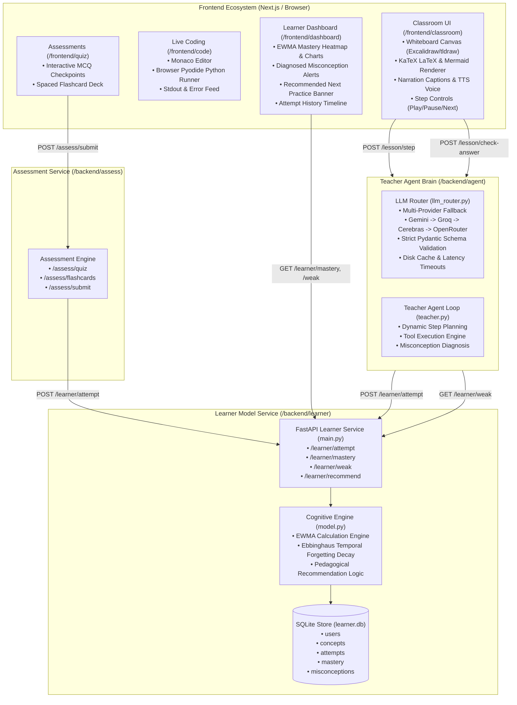
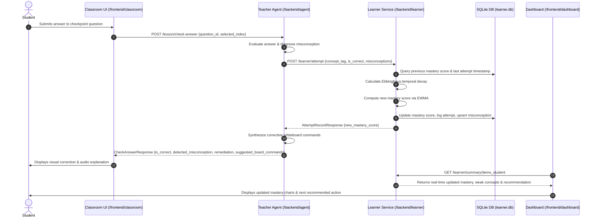
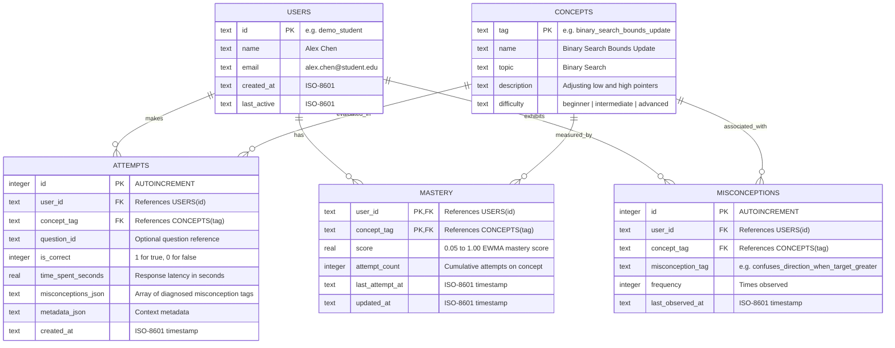

# AI Virtual Teacher: System Architecture & Data Flow

## 1. Executive Summary

The AI-Powered Interactive Virtual Teacher is an agentic education platform designed to replicate a 1-on-1 human tutoring experience. Instead of static text or passive video, the system orchestrates an active multimodal loop:
1. **Interactive Digital Whiteboard**: Step-by-step visual narration using structured geometric commands, LaTeX KaTeX formulas, and Mermaid charts.
2. **In-Browser Live Coding**: Execution of real Python code via Pyodide without requiring server-side compute sandboxes.
3. **Formative Understanding Checkpoints**: Frequent multiple-choice checkpoints that evaluate student thinking.
4. **Cognitive Misconception Diagnosis**: Rather than simple right/wrong grading, errors are matched against known misconception taxonomies.
5. **Adaptive Learner Model**: An Exponentially Weighted Moving Average (EWMA) knowledge graph with temporal forgetting decay that tracks concept-level mastery in real time.

---

## 2. End-to-End System Architecture

---

## 3. Sequence Flow: The Adaptive Remediation Loop

---

## 4. Learner Database Schema (SQLite)

---

## 5. Mathematical Models

### 5.1 Exponentially Weighted Moving Average (EWMA)
To compute smooth, adaptive mastery updates that respond quickly to newly learned concepts without fluctuating erratically:

$$M_{t} = \alpha_{\text{eff}} \cdot R_{t} + (1 - \alpha_{\text{eff}}) \cdot M_{t-1}$$

Where:
- $R_{t} \in [0.0, 1.0]$ is the performance on the current attempt (1.0 for correct, 0.0 for incorrect, with time-efficiency micro-adjustments).
- $\alpha_{\text{eff}} = \min\left(0.50, \alpha_{\text{base}} \cdot \frac{1.5}{\sqrt{N_{\text{attempts}}}}\right)$, ensuring high responsiveness during initial attempts and stability as confidence grows.
- $M_{t}$ is bounded strictly to $[0.05, 1.00]$.

### 5.2 Ebbinghaus Forgetting Decay
Knowledge decays when a student does not practice a concept over extended periods:

$$M_{\text{decayed}} = M_{\text{last}} \cdot e^{-\lambda \cdot \Delta t}$$

Where:
- $\Delta t$ is the elapsed time in days since $t_{\text{last\_attempt}}$.
- $\lambda = 0.03$ (approx. 3% decay per day of inactivity, retaining foundational retention).

---

## 6. Diagnosed Misconception Taxonomy (Binary Search Benchmark)

| Misconception Tag | Student Mistake | Pedagogical Remediation |
|---|---|---|
| `confuses_direction_when_target_greater` | Sets `high = mid - 1` when `target > arr[mid]` | Pointer shift logic: when target is larger, the target must lie in the right sub-array (`low = mid + 1`). |
| `confuses_low_with_high_shift` | Inverts `low` and `high` pointer updates | Clear visual distinction between left bound (`low`) and right bound (`high`). |
| `fails_to_exclude_checked_midpoint` | Sets `low = mid` or `high = mid` | Exclude checked midpoint: always shift by $+1$ or $-1$ to prevent infinite loops. |
| `infinite_loop_on_two_elements` | Does not terminate on two adjacent items | Integer floor division ensures progress toward single-element termination. |
